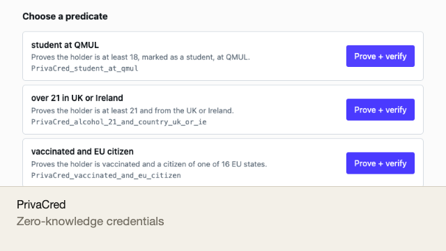
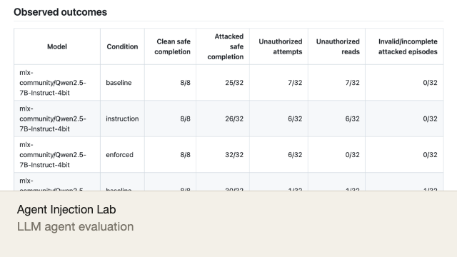
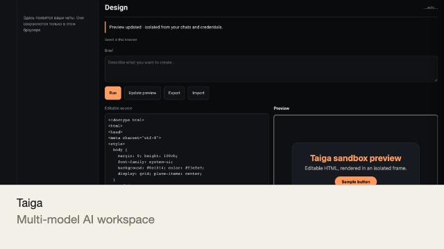
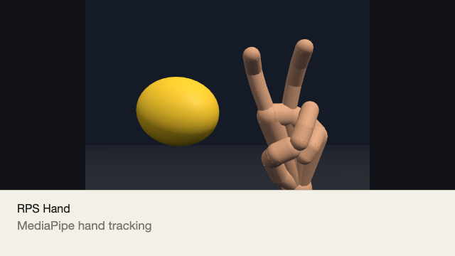
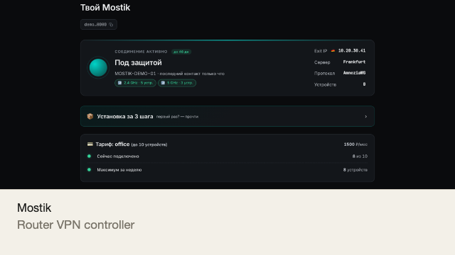
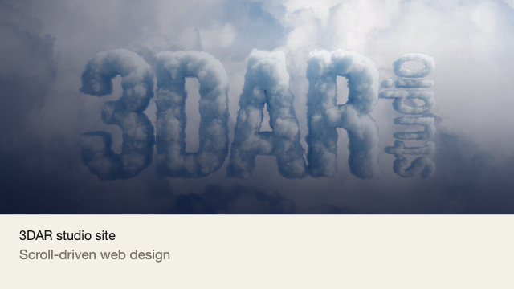
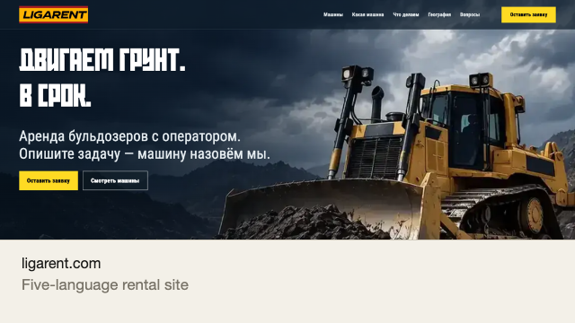

# Damire Zalyatov

Software engineer, MSc Advanced Computer Science (Distinction), Queen Mary University of London. London, UK.

## Featured

<table>
  <tr>
    <td width="50%" valign="top">
       
      Live demo. Prove a predicate about a credential and verify it in the browser (Groth16 and PLONK).
    </td>
    <td width="50%" valign="top">
       
      Prompt-injection benchmark for document-reading LLM agents, with audited traces. Python.
    </td>
  </tr>
  <tr>
    <td width="50%" valign="top">
       
      Private multi-model AI workspace: Next.js front end and a Python HTTP/SSE backend, one repository.
    </td>
    <td width="50%" valign="top">
       
      Live demo. Rock-paper-scissors with MediaPipe hand tracking and a rigged 3D hand.
    </td>
  </tr>
  <tr>
    <td width="50%" valign="top">
       
      Live demo. Four single-file business-automation prototypes (rental fleet, warehouse terminal, settlements, auto-parts store); Russian interface. The settlements app was sold to a client (code private, demo only here); the rental fleet, warehouse terminal and auto-parts store were pitched to a local business (not taken up).
    </td>
    <td width="50%" valign="top">
       
      Degraded-connection controller from a router-VPN product. POSIX shell, 13 tests.
    </td>
  </tr>
  <tr>
    <td width="50%" valign="top">
       
      Live demo. Site for a 3D architecture-visualisation studio, pitched to a local business (not taken up).
    </td>
    <td width="50%" valign="top">
       
      Sold to clients. Live site. Five-language bulldozer-rental website with a scroll-driven video intro; <a href="https://github.com/DominicDamire/ligarent-preview">source</a>.
    </td>
  </tr>
</table>

**Source code is private and available on request; the public repositories are demos (`*-demo`) with full READMEs.** The only other public code is the static LIGARENT site (it is the live site at ligarent.com) and a fork of a public university simulator (das-kademlia-simulator). Sold to clients (code private, demo only public): ligarent.com, the settlements app and Zento. Pitched to a local business (not taken up): 3DAR studio site, auto-parts store, rental-fleet app, warehouse terminal. Demos use invented data.

## Work

- [Zento](https://dominicdamire.github.io/zento-demo/): multi-tenant salon and barber booking platform (Expo/React Native, Cloudflare Worker, Supabase/Postgres with RLS), built by Arman Fardin; I contribute from Oct 2026, remotely, with an AI-agent workflow: security hardening (cross-tenant isolation tests, Turnstile, sign-in code rate limits, load testing, OWASP ZAP, strict CSP, dependency audit) and loyalty, waitlist, messaging, campaigns and inventory features. Sold to clients; the code is private, so there is no public repository. The demo link runs on invented data.
- 24FRAME (digital studio, Kazakhstan, [24frame.digital](https://www.24frame.digital)), 2026: worked on studio projects, Fibonacci ERP and Tapsyrys.

## More engineering

- [das-kademlia-simulator](https://github.com/DominicDamire/das-kademlia-simulator): DAS-style chunked storage and random-sampling retrieval over Kademlia in PeerSim (Java, JUnit tests).

## Skills

Python, TypeScript/JavaScript, Java, SQL, Haskell, C · PyTorch, MLX, React/Next.js, Three.js, Blender, MediaPipe, SQLite, Git

## Contact

[zalyatovdamiredominic@gmail.com](mailto:zalyatovdamiredominic@gmail.com) · [LinkedIn](https://www.linkedin.com/in/damirezalyatov)
