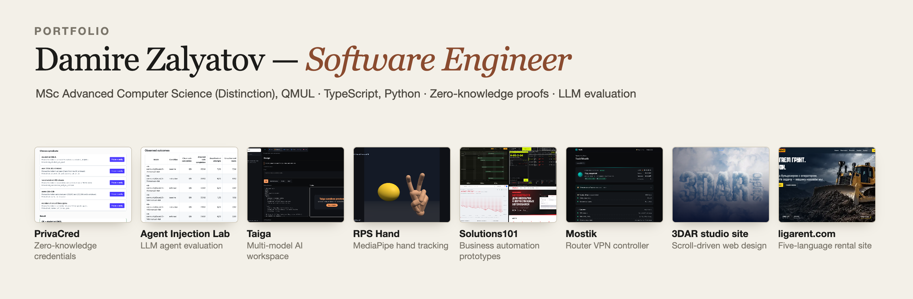
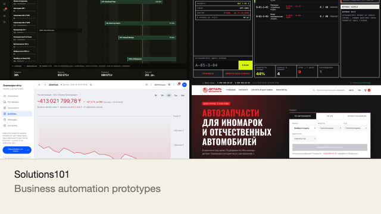

# Damire Zalyatov

Software engineer, MSc Advanced Computer Science (Distinction), Queen Mary University of London. London, UK.

## Featured

<table>
  <tr>
    <td width="50%" valign="top">
       
      Live demo. Prove a predicate about a credential and verify it in the browser (Groth16 and PLONK).
    </td>
    <td width="50%" valign="top">
       
      Prompt-injection benchmark for document-reading LLM agents, with audited traces. Python.
    </td>
  </tr>
  <tr>
    <td width="50%" valign="top">
       
      Private multi-model AI workspace; Next.js front end, with a <a href="https://github.com/DominicDamire/taiga-backend">Python backend</a>.
    </td>
    <td width="50%" valign="top">
       
      Live demo. Rock-paper-scissors with MediaPipe hand tracking and a rigged 3D hand.
    </td>
  </tr>
  <tr>
    <td width="50%" valign="top">
       
      Live index of four single-file business-automation demos (Russian interface).
    </td>
    <td width="50%" valign="top">
       
      Degraded-connection controller from a router-VPN product. POSIX shell, 13 tests.
    </td>
  </tr>
  <tr>
    <td width="50%" valign="top">
       
      Live site. Multi-page 3D architecture-visualisation studio site with a scroll-driven video hero.
    </td>
    <td width="50%" valign="top">
       
      Live site. Five-language bulldozer-rental website; <a href="https://github.com/DominicDamire/ligarent-preview">source</a>.
    </td>
  </tr>
</table>

## More

- [3dar-studio-site](https://github.com/DominicDamire/3dar-studio-site): multi-page site for a 3D architecture-visualisation studio with a scroll-driven video hero. [Live](https://dominicdamire.github.io/3dar-studio-site/)
- [ligarent-preview](https://github.com/DominicDamire/ligarent-preview): source of [ligarent.com](https://ligarent.com/), a five-language bulldozer-rental site.
- [das-kademlia-simulator](https://github.com/DominicDamire/das-kademlia-simulator): DAS-style chunked storage and random-sampling retrieval over Kademlia in PeerSim (Java, JUnit tests).
- Solutions101 apps: [autopark](https://github.com/DominicDamire/s101-autopark) · [warehouse terminal](https://github.com/DominicDamire/s101-warehouse-terminal) · [accounting](https://github.com/DominicDamire/s101-accounting) · [auto parts](https://github.com/DominicDamire/s101-auto-parts)
- [automation-studio](https://github.com/DominicDamire/automation-studio): source of the Solutions101 studio site (React, Vite, three.js).

## Skills

Python, TypeScript/JavaScript, Java, SQL, Haskell, C · PyTorch, MLX, React/Next.js, Three.js, Blender, MediaPipe, SQLite, Git

## Contact

[zalyatovdamiredominic@gmail.com](mailto:zalyatovdamiredominic@gmail.com) · [LinkedIn](https://www.linkedin.com/in/damire-zalyatov-77b4572b2)
